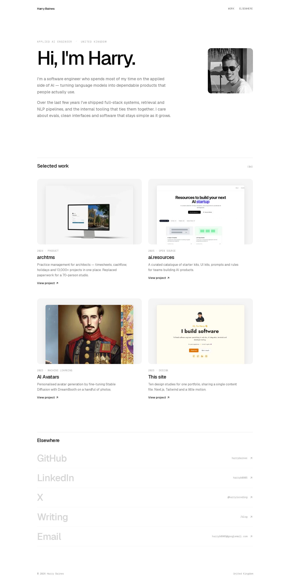
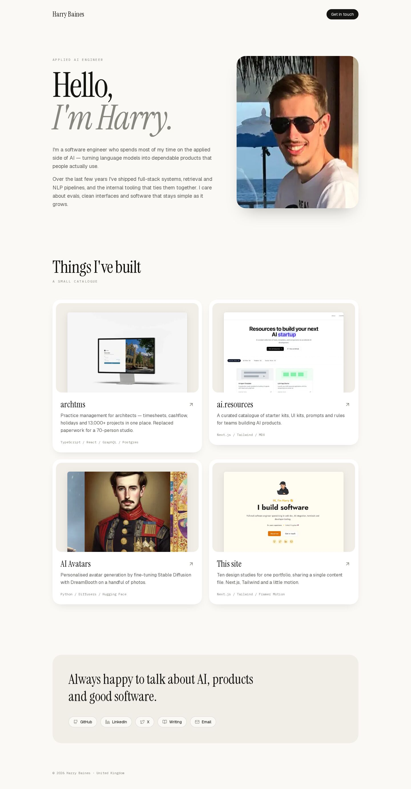
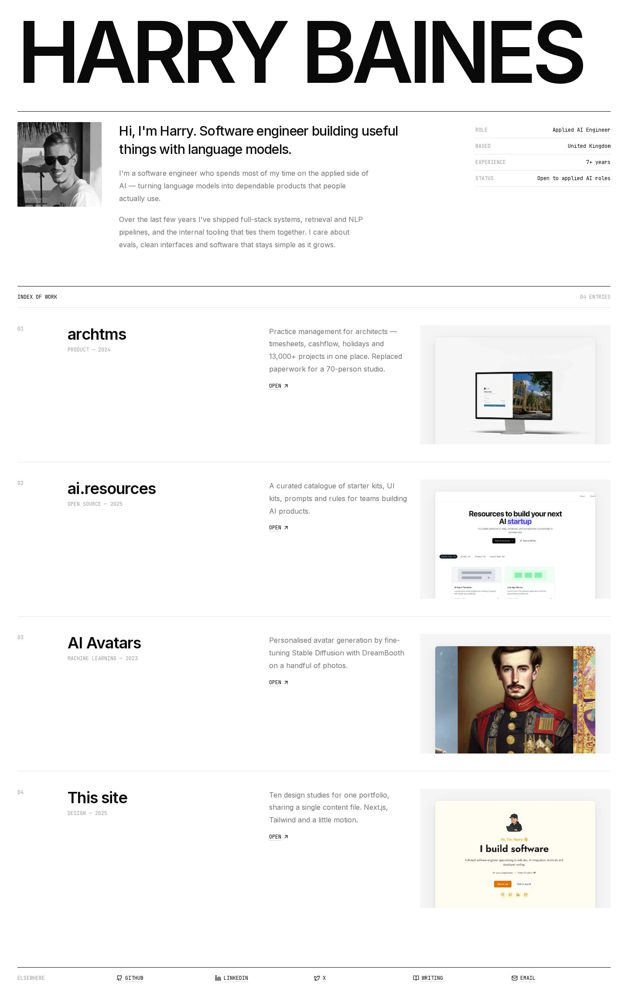
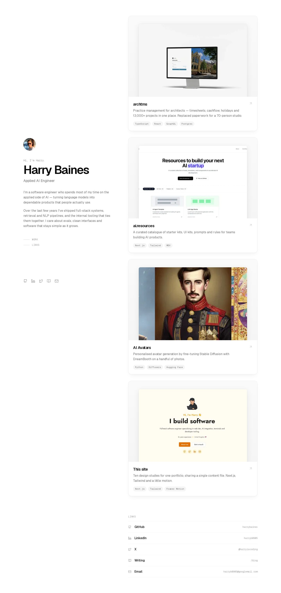
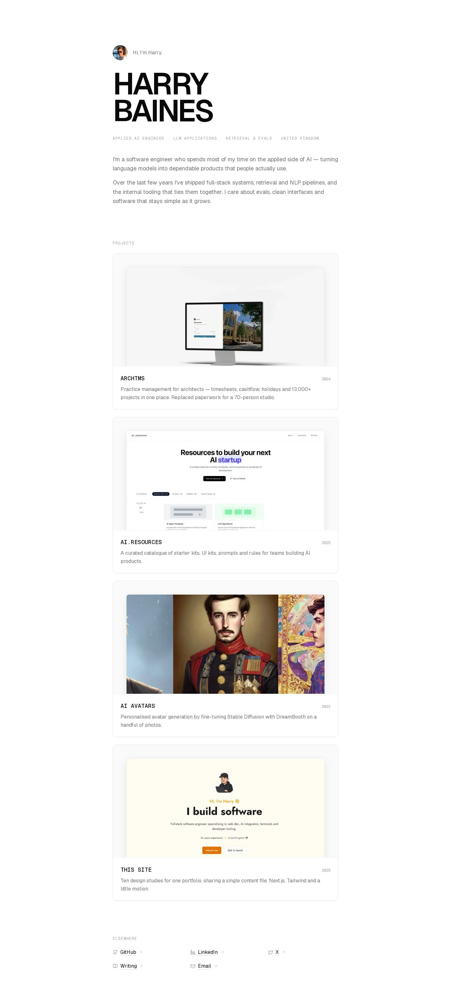
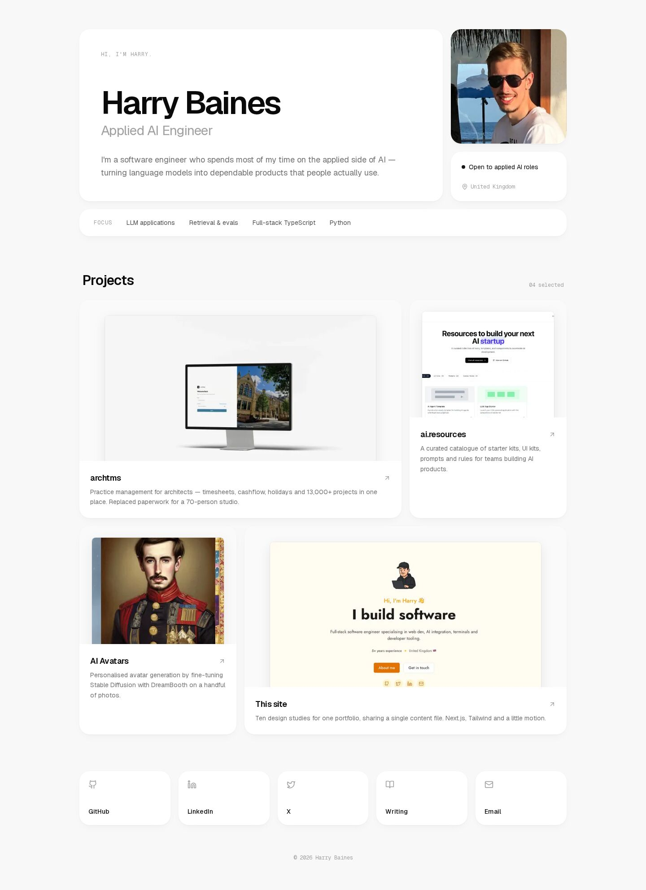
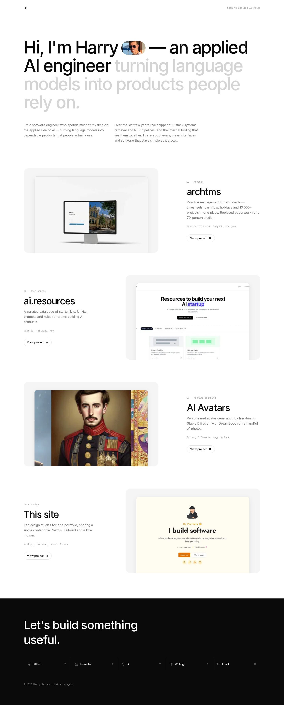
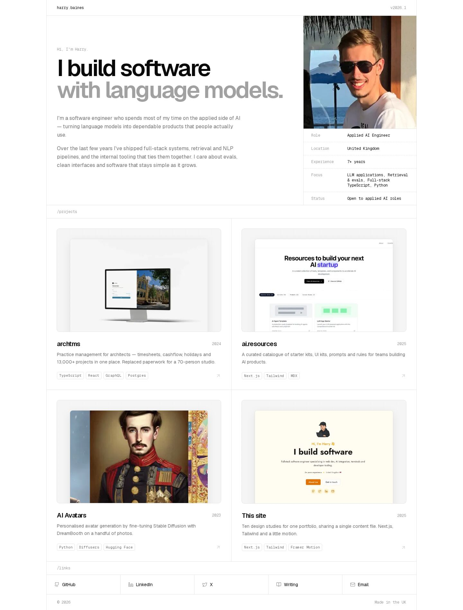
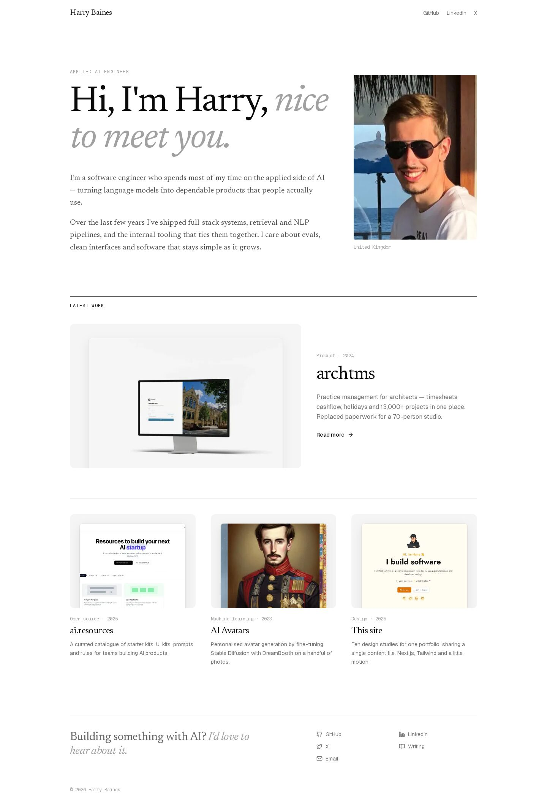
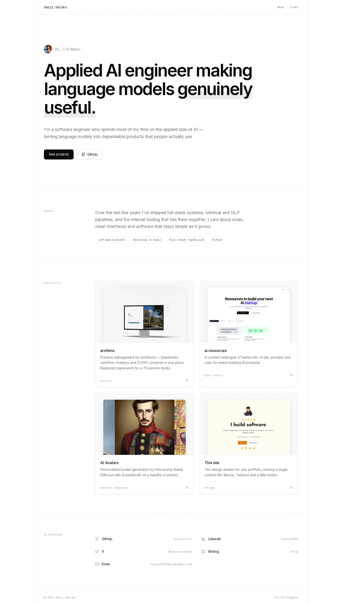

# Landing page variations

Ten design studies for the homepage. All of them render the same content from
[`app/content.ts`](../../app/content.ts). Browse them locally at `/v/01` … `/v/10`. Use the floating
switcher or the `[` / `]` keys to move between them.

To choose which one is served at `/`, set `DEFAULT_VARIATION` in
[`app/variations/index.ts`](../../app/variations/index.ts).

| #  | Name      | Idea |
| -- | --------- | ---- |
| 01 | Editorial | OpenAI-blog energy. Big sans greeting, quiet mono meta, a two-column project grid and oversized link rows. |
| 02 | Ivory     | Anthropic-style warm paper tones, an Instrument Serif display face, and white cards with soft shadows. |
| 03 | Index     | Swiss grid with a full-width uppercase name, a key/value spec list, and numbered catalogue rows. |
| 04 | Sidebar   | A sticky introduction on the left and a scrolling stack of shadowed project cards on the right. |
| 05 | Column    | skills.sh-inspired single centred column, a capitalised name and a dot-separated mono descriptor. |
| 06 | Bento     | White tiles on a soft grey canvas: intro, photo, status, focus, projects and links. |
| 07 | Showcase  | A statement headline with an inline portrait, alternating feature rows and a dark contact footer. |
| 08 | Spec      | Hairline datasheet cells, a spec table under the photo, and stack tags. Reads as an engineer's site without terminal clichés. |
| 09 | Journal   | Publication front page: Newsreader serif, one featured project and a three-up grid. |
| 10 | Rails     | Dashed guide rails with mono gutter labels (IBM Plex Mono), in the spirit of ai.resources. |

## 01 — Editorial

## 02 — Ivory

## 03 — Index

## 04 — Sidebar

## 05 — Column

## 06 — Bento

## 07 — Showcase

## 08 — Spec

## 09 — Journal

## 10 — Rails

